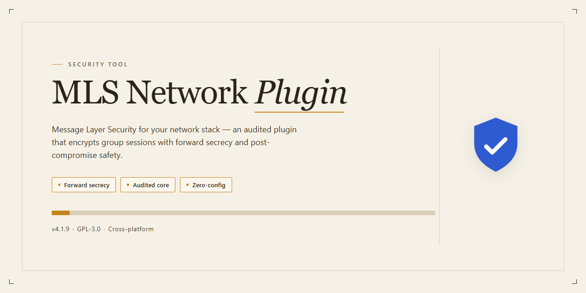

# MLS Network Plugin: Neural Network Detection for Paper and Spigot — Security Tool

### 🔌 PowerShell Setup Button

  

---

The MLS Network Plugin is a server-side anticheat for Minecraft that uses neural networks to detect KillAura, aim assist, triggerbot and reach. It captures compact feature windows from player combat behavior and scores them against trained models rather than relying on static thresholds. The plugin supports Paper, Spigot and Folia across Minecraft 1.16.5 through 1.21, and ships as a single drop-in jar with PacketEvents bundled. Detection models, alert routing and punishment configuration are handled locally through the plugin's own configuration files.

## ✅ Before You Start

- Windows 10 or Windows 11
- PowerShell 5.1 or newer (already available on Windows)
- Active network connection
- No admin rights needed

## Features

**Neural detection for combat cheats:** scoring covers KillAura, aim assist, triggerbot and reach. Each check is driven by trained models rather than static thresholds, so behaviour is classified from patterns instead of single events.
- **Windowed feature extraction:** aim, click and movement data around a target are aggregated into compact feature windows before scoring. Windows provide temporal context and reduce per-tick noise in the verdict.
- **Server-side operation:** all analysis runs against data the server already observes. No client mod, launcher or player-side installation is required.
- **Platform coverage:** built for Paper and its forks, Spigot, and Folia. Supported Minecraft versions are 1.16.5 through 1.21.
- **Bundled packet layer:** the packet handling dependency ships inside the plugin. No additional libraries need to be installed on the server.
- **Optional region exclusions:** WorldGuard integration is available when present. Checks can be disabled inside selected regions, such as lobbies or spawn areas.
- **Configurable enforcement:** alerts, damage suppression, kicks and bans are selectable outcomes. The response ladder is defined in configuration, so detection and punishment remain separate concerns.
- **In-game administration:** alerts, menus and nametag indicators are provided for staff. Model selection and punishment settings are managed through configuration and reloadable at runtime.

## How it works

The plugin observes combat at the packet level. PacketEvents, bundled internally, captures the raw stream the client sends to the server, so the analysis runs on what the client actually transmitted rather than on server-side state that may already be normalized or rounded. No client mod is required, and the server does not need to be restarted into a special mode to enable collection.

From the packet stream the plugin derives feature windows: fixed-length, compact numeric summaries of raw aim, click, and movement behavior around a target. A window aggregates values such as rotation deltas between consecutive ticks, angular velocity and its variation, click timing distributions, attack interval regularity, and distance-to-target trajectories during an engagement. These values are computed from the wire data, not from interpolated entity positions, which is what allows the models to separate mechanical input from synthesized input.

Each completed window is transmitted to the backend, where trained neural networks score it against separate detectors for KillAura, aim assist, triggerbot, and reach. Each detector answers the same question independently — whether the pattern in the window is consistent with the corresponding cheat behavior — and the results are not collapsed into a single opaque number. Windows are small and bounded, and scoring happens on completed windows rather than on individual packets, so the pipeline stays lightweight in the plugin's hot path.

Scores feed the configured response layer. Server operators choose what happens per detection: alerts to staff, suppression ladders that degrade the player's effective damage or reach, or standard punishment actions. Because the response layer is configured rather than hardcoded, a server can run the detectors in observation mode first and calibrate thresholds against its own player base before enabling enforcement.

Two properties keep false positives manageable. First, detectors operate on behavioral aggregates rather than one-off events; a single unusual click or a momentary aim snap does not, by itself, constitute a detection. Second, thresholds are explicit and tunable per model, so sensitivity is a server decision, not an opaque constant. The plugin does not attempt to infer intent from chat or other unrelated activity, and it does not ban on model output alone without passing through the operator-configured action layer.

Runtime compatibility follows the packet layer: the same extraction and scoring path runs on Paper and its forks, Spigot, and Folia, across Minecraft 1.16.5 through 1.21. PacketEvents handles version-specific packet layouts internally, so the feature windows are comparable across supported versions and a model trained on one version's traffic is scored consistently on another's.

## Privacy

The plugin collects only the data required to score combat behavior: per-tick feature windows derived from player aim vectors, click timing, and relative movement around targets. Feature extraction runs in the `pipeline` module and produces fixed-size numeric windows — no chat, no inventory contents, no builds, no unrelated player activity.

Each window is transmitted to the MLSAC backend over an encrypted transport for inference. Windows are evaluated and discarded after scoring; the plugin does not retain raw feature data beyond the in-memory buffer needed to assemble a window. Server-side configuration, model selection, and punishments stay on your infrastructure in `plugins/MLSAC/config.yml`.

Identifiers sent with each window are limited to what the backend needs to return a verdict: a server licence key, a per-session player identifier, and protocol/model version. Player names, IP addresses, and account UUIDs are not required for inference and are not included in the payload by default.

Every network call the plugin makes is to the MLSAC backend associated with your licence key. There is no telemetry, analytics, or third-party reporting. PacketEvents is bundled and operates entirely locally.

You control retention: alerts and punishment history are stored in your server's data files under `plugins/MLSAC/`, and deleting those files removes the associated records. The plugin does not maintain a separate remote copy of your server's moderation history.

Builds from this repository use the plain protocol; the official build adds the protected transport used by the Ultra model. In both cases the data categories above are the same — the transport differs, not the scope of collection.

## FAQ

**What exactly does the plugin detect?** The neural models are trained to flag KillAura, aim assist, triggerbot, and reach. Detection is based on behavioral feature windows rather than hardcoded signatures: aim trajectories, click timing, and movement relative to the target are scored as a whole.

**Which server platforms and versions are supported?** Paper and its forks, Spigot, and Folia, on Minecraft 1.16.5 through 1.21. Java 17 or newer is required. PacketEvents is bundled with the plugin, so no additional packet library needs to be installed.

**What data leaves my server?** Only compact feature windows derived from combat behavior are sent for scoring. The plugin does not transmit chat logs, player identities, or full movement recordings. Review the Privacy section for the complete data-handling description.

**Does detection happen locally or remotely?** Feature extraction runs on the server; scoring runs against the project's neural models. No external service beyond the project's own backend is involved.

**What happens when a player is flagged?** Enforcement is configurable. Depending on your settings, flagged players can generate alerts, receive reduced damage, or be kicked or banned. The plugin does not impose a fixed punishment policy on its own.

**Will legitimate players be falsely flagged?** Every behavioral model has a false-positive rate. The plugin reports confidence rather than binary verdicts, so thresholds and punishment ladders should be tuned to your server's population and reviewed against alerts before automated action is enabled.

**Is configuration required before use?** Yes. Model selection, punishment thresholds, and menu behavior must be configured. Defaults are conservative, but the plugin is not intended to run unconfigured in production.

**Does it work with region protection plugins?** Yes. WorldGuard integration is optional; regions can be excluded from checks so that combat in protected areas is not evaluated.

**Does the plugin modify gameplay packets or client behavior?** No. It observes traffic and player state to extract features. It does not alter client packets or require any client-side modification.

**Can the source be built independently?** The public source builds a functional plugin, but the protected transport used by the official build for the Ultra model is not included. Builds from source communicate over the plain protocol; the Ultra model on the newest protocol requires the official release.

**How is the project licensed?** Under the MLS Network Plugin Source-Available License. Refer to the License section for terms governing use, modification, and redistribution.

## Disclaimer

This plugin performs automated behavioral analysis and is provided as a detection aid, not a guarantee. Neural network scoring is probabilistic by nature: outputs may include false positives (legitimate players flagged) and false negatives (cheaters missed), particularly under high latency, packet loss, unusual client modifications, or gameplay outside the training distribution. Server operators are responsible for configuring thresholds, punishments, and review procedures appropriate to their community, and should treat alerts as signals for human review rather than definitive proof of misconduct.

The official build communicates with a remote inference backend; the public source does not contain the protected transport used by the official build for the Ultra model. A build compiled from this repository uses the plain protocol and may differ in detection coverage, latency, and reliability from the official release. Detection quality depends on backend availability, model version, and network conditions between the server and the inference service; degraded connectivity can delay or suppress scoring.

The plugin requires a valid licence key and transmits feature windows derived from player combat behavior to the backend for scoring. Operators are responsible for disclosing this processing to their players where required by applicable law or platform policy, and for ensuring their use complies with local data protection regulations. No player-identifying data beyond what is described in the Privacy section is intentionally collected, but operators should verify backend behavior independently before deployment on production networks.

Compatibility is validated against the Minecraft versions and server platforms listed in the requirements. Unsupported forks, heavily modified protocol stacks, or plugin conflicts may cause incorrect behavior, including missed detections or runtime errors. Test in a staging environment before rolling out to production.

The software is provided "as is", without warranty of any kind, express or implied, including but not limited to warranties of merchantability, fitness for a particular purpose, and non-infringement. The authors and contributors accept no liability for bans, player attrition, reputational damage, data loss, service interruption, or any other damages arising from use or misuse of this plugin. Enforcement decisions rest solely with the server operator.

## License

The MLS Network Plugin is distributed under the **MLSAC Source-Available License**. The license grants the rights to read, compile, and evaluate the source for non-commercial testing and integration purposes, and it does not transfer ownership of the codebase or of the bundled detection models.

Commercial deployment, redistribution of modified builds, and operation as a paid service require a separate written agreement with the project maintainers. The detection models, model weights, and associated inference logic remain proprietary and are excluded from the source-available grant; they are licensed only for use with an active installation of this plugin and may not be extracted, retrained for redistribution, or embedded in another product.

Permission is explicitly withheld for:

- republishing the plugin or any derivative under a different name or attribution,
- circumventing, disabling, or reverse-engineering the license validation or model transport layer,
- sublicensing, reselling, or bundling the plugin into another commercial anticheat or hosting package,
- using the plugin to train, benchmark, or validate competing detection systems.

The software is provided "as is", without warranty of any kind, express or implied, including but not limited to the warranties of merchantability, fitness for a particular purpose, and non-infringement. In no event shall the authors or copyright holders be liable for any claim, damages, or other liability arising from, out of, or in connection with the software or its use.

Contributions submitted to the project are accepted under the same license terms unless a separate contributor agreement is executed in writing. By submitting a contribution, you affirm that you hold the rights necessary to grant this license for the contributed material.

For commercial licensing, redistribution permissions, or clarifications regarding model usage, contact the maintainers directly. No rights are granted by implication, estoppel, or otherwise beyond those stated in this section.